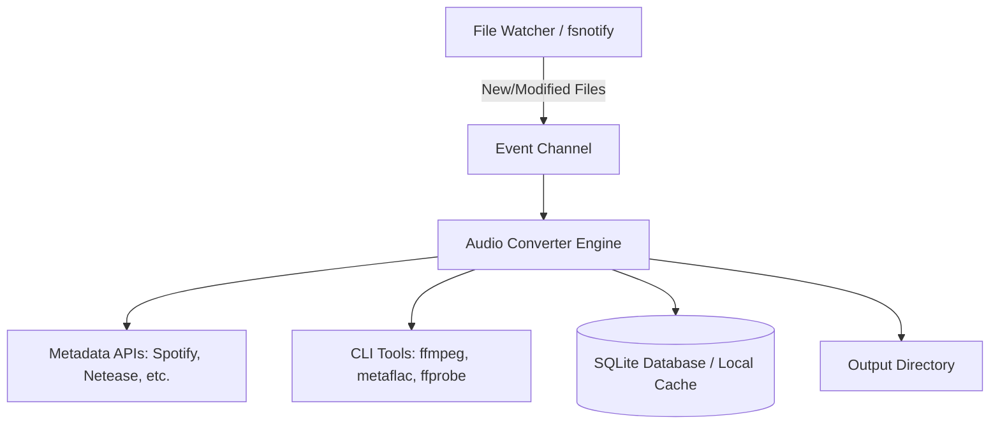

# Codebase Map (CODEMAP.md)

> **Last Updated**: 2026-09-19
> **Maintained By**: explorer agent  
> **Purpose**: Single source of truth for physical topology, module dependencies, service ports, and forbidden zones.

---

## 1. System Architecture Overview (系统架构总览)

MusicConvert 是一个基于本地文件系统的守护进程工具，用于监听特定目录的音频文件并进行转码和元数据补全。

---

## 2. Directory & Module Map (目录与模块映射)

| Path | Module Name | Language / Framework | Description |
| :--- | :--- | :--- | :--- |
| `crates/music-core/` | Core Domain & Storage | Rust / Cargo | 核心领域模型 (`model.rs`)、配置解析 (`config.rs`)、SQLite 存储 (`db.rs`) 与文本治理 (`text/` 繁简/路径规范化) |
| `crates/music-provider/` | Metadata Provider Chain | Rust / Cargo | 异步元数据责任链：`core/` (契约接口与责任链)、`clients/` (MusicBrainz, NetEase, iTunes) 与 `rules/` (中文与古典乐清洗) |
| `crates/music-audio/` | Audio Pipeline Engine | Rust / Cargo | 音频编解码分轨：`drivers/` (ffmpeg, ffprobe, metaflac)、`cue/` (纯 Rust CUE 解析) 与 `policy/` (多碟路径拓扑与缺失曲目追踪) |
| `crates/music-convert/` | Daemon & CLI Entry | Rust / Cargo | 应用程序总控：`app/` (命令行 clap)、`monitor/` (ReleaseBatch 聚类扫描与 notify 监听) 与 `engine/` (转码编排调度中枢) |
| `api/` | Metadata APIs (Go) | Go | 原 Go 版外部音乐元数据服务交互 |
| `audio/` | Audio Processor (Go) | Go | 原 Go 版音频转码与 CUE 处理 |
| `config/` | Config Manager (Go) | Go / YAML | 原 Go 版配置管理 |
| `db/` | Database (Go) | Go / SQLite | 原 Go 版 SQLite 操作 |
| `model/` | Data Models (Go) | Go | 原 Go 版核心数据结构 |
| `util/` | Utilities (Go) | Go | 原 Go 版通用工具库 |
| `scripts/` | Automation Scripts | Bash / PowerShell | 跨平台自动化调度、门禁自检与构建脚本 |

---

## 3. Network Ports & External Services (网络端口与外部服务)

本项目为本地守护进程，**不暴露任何内/外部网络端口**，但依赖以下外部服务进行出站请求：

| Target Service | Protocol | Purpose |
| :--- | :--- | :--- |
| Spotify API | HTTPS | 音乐元数据拉取（尤其适用于外语音乐） |
| NetEase Music | HTTPS | 音乐元数据拉取（适用于中文音乐、歌词） |
| Discogs / MusicBrainz | HTTPS | 实体唱片信息及兜底元数据 |
| iTunes / Wikipedia | HTTPS | 补充和校验元数据信息 |

---

## 4. Forbidden Zones & Protection Rules (禁区与保护规则)

根据 `agents.config.yaml` 定义，以下路径为受保护的禁区，涉及核心数据模型、通信协议和底层共享库的变更。如果必须修改，需要附带对应的 Waiver Tag：

| Path Pattern | Risk Level | Reason | Required Waiver Tag |
| :--- | :--- | :--- | :--- |
| `core/models/**` | High | 核心数据模型与数据库实体变更，级联影响系统稳定性 | `[schema]` |
| `api/proto/**` | Critical | 通信协议契约变更，需与前后端/微服务达成一致 | `[proto]` |
| `shared/libs/**` | Medium | 底层共享库与核心工具包 | `[shared]` |

> Note: 虽然当前项目中未实际探测到 `core/models` 等特定物理目录，但根据安全红线规定，上述模式若被匹配则自动拦截。建议后续在配置中对齐实际数据模型层（例如 `model/` 和 `db/`）。
