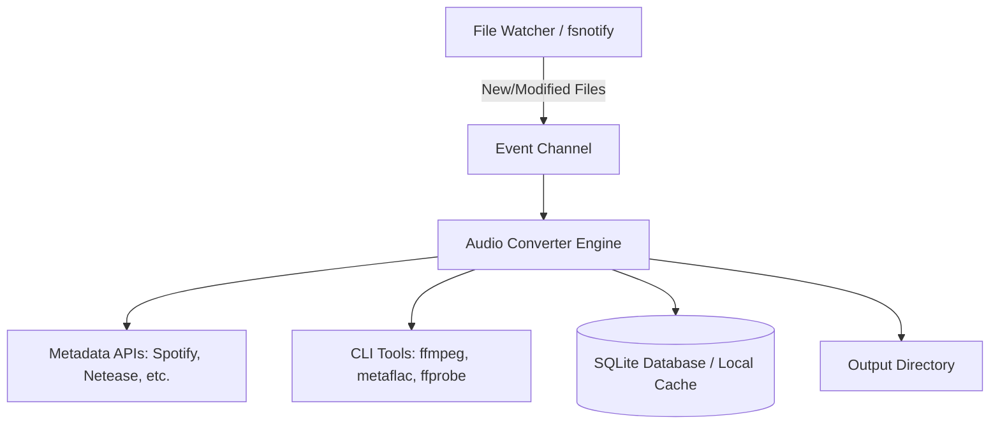

# Codebase Map (CODEMAP.md)

> **Last Updated**: 2026-09-19
> **Maintained By**: explorer agent  
> **Purpose**: Single source of truth for physical topology, module dependencies, service ports, and forbidden zones.

---

## 1. System Architecture Overview (系统架构总览)

MusicConvert 是一个基于本地文件系统的守护进程工具，用于监听特定目录的音频文件并进行转码和元数据补全。

---

## 2. Directory & Module Map (目录与模块映射)

| Path | Module Name | Language / Framework | Description |
| :--- | :--- | :--- | :--- |
| `api/` | Metadata APIs | Go | 与外部音乐元数据服务（Discogs, iTunes, MusicBrainz, NetEase, Spotify, Wikipedia）交互 |
| `audio/` | Audio Processor | Go | 音频转码逻辑（FFmpeg/FFprobe/metaflac 调用）及 CUE 文件处理 |
| `config/` | Config Manager | Go / YAML | 集中化配置管理（读取 `config.yaml`） |
| `db/` | Database | Go / SQLite | 本地 SQLite 数据库操作，存储和管理转码记录 (`music.go`) |
| `model/` | Data Models | Go | 核心数据结构定义 (`comm.go`) |
| `util/` | Utilities | Go | 通用工具库：简繁体转换、命令行执行、文件系统操作等 |
| `scripts/` | Automation Scripts | PowerShell / Bash | 自动化、质量门禁与构建脚本 |

---

## 3. Network Ports & External Services (网络端口与外部服务)

本项目为本地守护进程，**不暴露任何内/外部网络端口**，但依赖以下外部服务进行出站请求：

| Target Service | Protocol | Purpose |
| :--- | :--- | :--- |
| Spotify API | HTTPS | 音乐元数据拉取（尤其适用于外语音乐） |
| NetEase Music | HTTPS | 音乐元数据拉取（适用于中文音乐、歌词） |
| Discogs / MusicBrainz | HTTPS | 实体唱片信息及兜底元数据 |
| iTunes / Wikipedia | HTTPS | 补充和校验元数据信息 |

---

## 4. Forbidden Zones & Protection Rules (禁区与保护规则)

根据 `agents.config.yaml` 定义，以下路径为受保护的禁区，涉及核心数据模型、通信协议和底层共享库的变更。如果必须修改，需要附带对应的 Waiver Tag：

| Path Pattern | Risk Level | Reason | Required Waiver Tag |
| :--- | :--- | :--- | :--- |
| `core/models/**` | High | 核心数据模型与数据库实体变更，级联影响系统稳定性 | `[schema]` |
| `api/proto/**` | Critical | 通信协议契约变更，需与前后端/微服务达成一致 | `[proto]` |
| `shared/libs/**` | Medium | 底层共享库与核心工具包 | `[shared]` |

> Note: 虽然当前项目中未实际探测到 `core/models` 等特定物理目录，但根据安全红线规定，上述模式若被匹配则自动拦截。建议后续在配置中对齐实际数据模型层（例如 `model/` 和 `db/`）。
