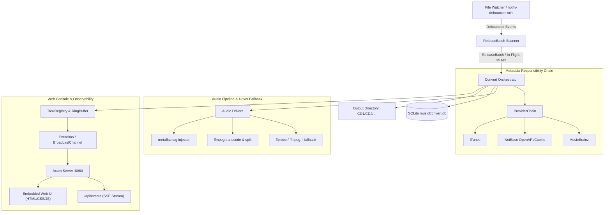

# Codebase Map (CODEMAP.md)

> **Last Updated**: 2026-11-08
> **Maintained By**: explorer agent  
> **Purpose**: Single source of truth for physical topology, module dependencies, service ports, and forbidden zones.

---

## 1. System Architecture Overview (系统架构总览)

MusicConvert 是一个基于高性能纯 Rust 工作空间构建的本地音乐转换与元数据治理引擎，包含后台守护监听、多源责任链富化、音频转码/分轨以及全生命周期可视化的 Web 控制台：

---

## 2. Directory & Module Map (目录与模块映射)

| Path | Module Name | Language / Framework | Description |
| :--- | :--- | :--- | :--- |
| `crates/music-core/` | Core Domain & Storage | Rust / Cargo | 核心领域模型 (`model.rs`)、配置解析 (`config.rs`)、SQLite 存储 (`db.rs`) 与文本治理 (`text/` 繁简转换、路径清洗与 8.3 短名防逃逸) |
| `crates/music-provider/` | Metadata Provider Chain | Rust / Cargo | 异步元数据责任链：`core/` (契约接口与动态优先级责任链)、`clients/` (MusicBrainz, NetEase, iTunes) 与 `rules/` (中文优先与古典乐 Op./No. 保护规则) |
| `crates/music-audio/` | Audio Pipeline Engine | Rust / Cargo | 音频处理引擎：`drivers/` (ffmpeg 转码分轨、ffprobe/ffmpeg 降级探测、metaflac 标签注入)、`cue/` (纯 Rust CUE 解析) 与 `policy/` (多碟 `CD 01`/`Disc 1` 推断、纯曲名清洗与 `missing_tracks.txt` 追踪) |
| `crates/music-convert/` | Daemon, Server & CLI | Rust / Cargo | 应用程序总控：`app/` (命令行 clap)、`monitor/` (ReleaseBatch 聚类扫描与 notify 监听，硬屏蔽 `@eaDir`)、`engine/` (转码编排调度中枢、TaskRegistry 历史去重、TaskLogItem 结构化诊断日志) 与 `server/` (Axum REST API、SSE 实时链路、静态内嵌 Web 控制台) |
| `web/dist/` | Frontend Web UI Assets | HTML5 / CSS3 / JS | 响应式暗色管理控制台：任务列表卡片、`📜 抓取日志` 展开面板、`🖥️ 实时日志` 抽屉终端、人工审阅修正 Modal、已转换库分页与搜索 |
| `legacy/go/` | Legacy Archive (Go) | Go / SQLite | 历史 Go 实现完整归档（含原 api/, audio/, config/, db/, model/, util/），作为只读参考与比对资产 |
| `scripts/` | Automation Scripts | Bash / PowerShell | 跨平台自动化调度（`Invoke-Build.sh`）、双轨门禁核验与群晖生产交叉构建脚本 (`build_synology.sh`) |

---

## 3. Network Ports & External Services (网络端口与外部服务)

### 3.1 监听服务端口 (Inbound)
| Service / Endpoint | Port | Protocol | Purpose |
| :--- | :--- | :--- | :--- |
| Axum Web Console & API | `8080` (默认可配置) | HTTP / SSE | 嵌入式管理控制台、RESTful 控制接口 (`/api/tasks`, `/api/scan`) 与实时事件流 (`/api/events`) |

### 3.2 出站请求外部服务 (Outbound)
| Target Service | Protocol | Purpose |
| :--- | :--- | :--- |
| NetEase Music OpenAPI / Web | HTTPS | 中文发行、曲目表校对、拼音还原与歌词 |
| MusicBrainz | HTTPS | 西文专辑权威元数据、Release 匹配与官方曲序 |
| iTunes Search API | HTTPS | 专辑级补全、标准专辑名与高清封面兜底 |
| Spotify API | HTTPS | 补充西文凭据与查询候选 |
| Discogs | HTTPS | 实体唱片、目录号及古典盒装元数据补充 (需配置 Token) |

---

## 4. Forbidden Zones & Protection Rules (禁区与保护规则)

根据 `agents.config.yaml` 定义，以下路径为受保护的禁区：

| Path Pattern | Risk Level | Reason | Required Waiver Tag |
| :--- | :--- | :--- | :--- |
| `core/models/**` | High | 核心数据模型与数据库实体变更，级联影响系统稳定性 | `[schema]` |
| `api/proto/**` | Critical | 通信协议契约变更，需与前后端/微服务达成一致 | `[proto]` |
| `shared/libs/**` | Medium | 底层共享库与核心工具包 | `[shared]` |
