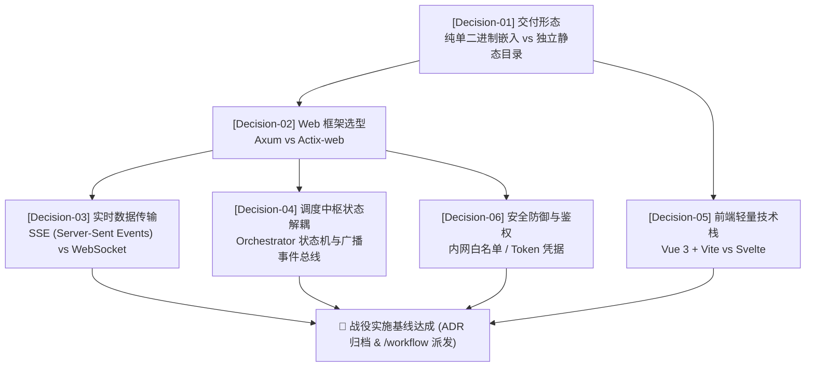

# Wayfinder 架构迷雾航海图: WebUI 控制台与 REST/SSE 调度服务

> **战役代号**: `MISSION-WEBUI`  
> **战略目标**: 为 `MusicConvert` 构筑现代、轻量、单二进制交付、NAS 极度友好的可视化控制台与 API 调度引擎。  
> **状态**: 迷雾规划中 (Fog-of-War In-Progress)  
> **创建时间**: 2026-11-07  

---

## 🎯 战役终态愿景 (Mission Destination)

将 MusicConvert 从传统的“黑盒 CLI 守护进程”升维为“工业级可观测、可干预的媒体治理工作台”：
1. **全局仪表盘 (Dashboard)**: 实时展示系统运行状态、队列容量、CPU/内存开销、已转码曲目数与入库成功率；
2. **转码流实时监控 (Task Monitor)**: 进度条实时刷新、当前音轨/CUE 分轨状态展示、后端转码日志实时滚动回放；
3. **元数据交互核验与人工介入 (Review & Correction)**: 对多源元数据匹配置信度较低、或古典乐作品号存在冲突的专辑，挂起转码并在 Web 界面提示人工确认/编辑标签，确认后一键放行；
4. **历史审计与缺失曲目追踪 (Audit & Missing Tracks)**: 可视化检索 SQLite 已处理数据库，直观查看 `missing_tracks.txt` 列表并支持针对性重扫；
5. **单二进制交付保证 (Zero-Runtime Footprint)**: 前端静态资源在编译期内嵌进 Rust 二进制中，用户在 NAS 上依然只需要部署单个执行文件。

---

## 🧭 决策依赖拓扑 (Decision Dependency Graph)

---

## 📋 决策卡片清单 (Decision Tickets)

### [Decision-01] 交付形态与资源打包机制 (Packaging Strategy)
- **核心质询**: WebUI 前端资产是作为独立文件夹部署，还是在编译期完全内嵌到 Rust 二进制中？
- **候选方案**:
  - `方案 A (Recommended)`: **编译期内嵌 (Compile-time Embedded via `rust-embed`)**。Release 编译时将构建好的前端静态资产打包进二进制。用户在 NAS/Docker 环境下只需拷贝单一可执行文件，绝对零环境污染。
  - `方案 B`: **外挂独立静态目录 (`web/dist/`)**。前后端物理分离，前端构建产物作为额外文件夹分发。
- **推荐抉择**: **方案 A**。单二进制是 MusicConvert 在群晖等 NAS 上最受推崇的特性，绝不倒退引入散落文件夹。
- **阻塞依赖**: 无（根决策）。

---

### [Decision-02] Rust 异步 Web 框架选型 (Web Framework Selection)
- **核心质询**: 采用哪个 Rust Web 框架既能保证极低资源占用，又能与现有 Tokio/Tower/Tracing 架构天然融合？
- **候选方案**:
  - `方案 A (Recommended)`: **`axum`**。Tokio 官方主导，基于 Tower 与 Hyper 驱动。由于当前 `music-convert` 已经重度依赖 `tokio`、`tracing`，采用 axum 能实现零运行时摩擦、极其轻量的提取器（Extractors）与极小编译开销。
  - `方案 B`: **`actix-web`**。吞吐量极高，但拥有自己的独立 Runtime 抽象体系，对单机 NAS 轻量服务而言略显庞大。
- **推荐抉择**: **方案 A (`axum`)**。
- **阻塞依赖**: `Decision-01`。

---

### [Decision-03] 实时转码事件传输层 (Realtime Transport: SSE vs WebSocket)
- **核心质询**: 实时任务进度、状态机变迁与日志流回放，采用 SSE 还是 WebSocket？
- **候选方案**:
  - `方案 A (Recommended)`: **Server-Sent Events (SSE) 优先 + REST 控制**。转码进度与日志流本质上是服务端向客户端的“单向广播”。SSE 完全基于标准 HTTP/1.1，天然具备断线自动重连能力，且对群晖 DSM 内置反向代理（Nginx）具有 100% 穿透兼容性（需配置 `X-Accel-Buffering: no`）。用户的操作（重试、修正、配置）走标准 REST API。
  - `方案 B`: **全双工 WebSocket**。双向通信强，但握手较重，且在部分 NAS 复杂端口映射或非标准反向代理下容易产生握手失败。
- **推荐抉择**: **方案 A (SSE + REST)**。极简、稳健、低开销。
- **阻塞依赖**: `Decision-02`。

---

### [Decision-04] 调度中枢状态解耦与事件总线 (Engine State & Event Bus) [RESOLVED]
- **核心质询**: 当前 `ConvertOrchestrator` 是批处理线性执行逻辑，如何平滑支持 Web 端的实时状态查询与人工干预？
- **达成裁定**:
  - 1. **双层任务模型**: `BatchTask` (整专/多碟上下文、元数据整体状态) + `TrackItem` (音轨切分、标签写入与百分比进度)；
  - 2. **人工审阅触发策略**: **模式 A (存疑挂起)**。仅在无确切在线结果或存在多个近似候选时置入 `AwaitingReview`，高置信度自动化放行；
  - 3. **挂起与放行机制**: 基于 `tokio::sync::oneshot` 异步挂起调度流，Web 接口触发 `POST /api/tasks/{id}/approve` 唤醒继续；
  - 4. **实时事件与首屏同步**: `tokio::sync::broadcast::channel(256)` 驱动 SSE 实时推流，内存状态机维护 RingBuffer (缓存活跃任务 + 最近 50 条历史) 保证首屏秒级拉齐。
- **阻塞依赖**: `Decision-02` (已解除)。

---

### [Decision-05] 前端交互栈与 UI 架构 (Frontend Tech Stack)
- **核心质询**: 前端选用何种工具链能在保持精美现代界面的同时，打包产物体积控制在极致水准？
- **候选方案**:
  - `方案 A (Recommended)`: **Vue 3 + Vite + Tailwind CSS + Lucide Icons**。成熟现代，支持按需 Tree-shaking，整体 gzip 产物可压制在 150KB 以内，开发效率与维护性极高。
  - `方案 B`: **Svelte 5 + Vite**。编译期无虚拟 DOM，体积更小，但组件库生态丰富度相对较低。
- **推荐抉择**: **方案 A**。
- **阻塞依赖**: `Decision-01`。

---

### [Decision-06] 安全边界与访问控制 (Authentication & Security)
- **核心质询**: Web 控制台开放后，如何防止未授权访问或 NAS 局域网越权？
- **安全规约**:
  - 1. **默认绑定策略**: 默认监听 `127.0.0.1:8080` 或 `0.0.0.0:8080`（可在 `config.yaml` 灵活配置）；
  - 2. **轻量鉴权机制**: 支持在 `config.yaml` 中配置 `webui.auth_token`。若配置了 Token，前端请求需携带 `Authorization: Bearer <token>`；若未配置，默认开启本地内网可信访问。
- **阻塞依赖**: `Decision-02`。

---

## 🌫️ 侦察探明的迷雾风险 (Discovered Fog-of-War)

| 风险编号 | 潜在危险 (Pitfall) | 预警与消除手段 (Countermeasure) |
| :--- | :--- | :--- |
| **Risk-01** | 群晖 Nginx 反向代理下 SSE 缓冲截断，导致前端进度条卡死直到转码结束才一次性涌出 | SSE 响应头强制注入 `Cache-Control: no-cache`、`Content-Type: text/event-stream` 与 `X-Accel-Buffering: no` |
| **Risk-02** | 交叉编译 Linux/ARM 群晖二进制时缺少 Node.js 环境，导致嵌入资源缺失 | 在 `scripts/build_synology.sh` 前置检查前端产物，若未构建则自动执行 `npm run build`，若无 npm 则支持安全优雅降级 |
| **Risk-03** | 大量音频文件转码触发的高频日志导致浏览器 DOM 渲染卡顿 (Log Storm) | 前端日志视窗引入虚拟滚动（Virtual List），后端事件总线在批量转码时对进度事件做 100ms 级别合并防抖 |

---

## 🚀 远征行动建议 (Next Steps)

按照 Wayfinder 航海图规划，建议依次解决上述 **Decision Tickets**，形成正式架构决策（`docs/adr/0005-webui-and-api-server-architecture.md`），随后无缝移交至 `/workflow` 流水线开展工作树物理隔离实现！
